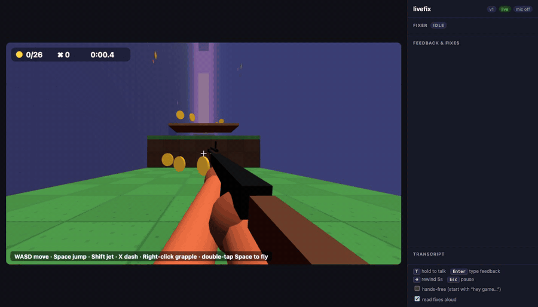
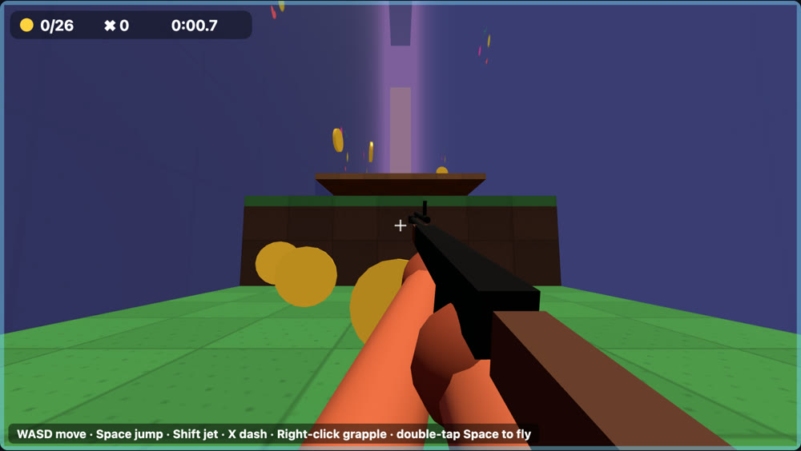
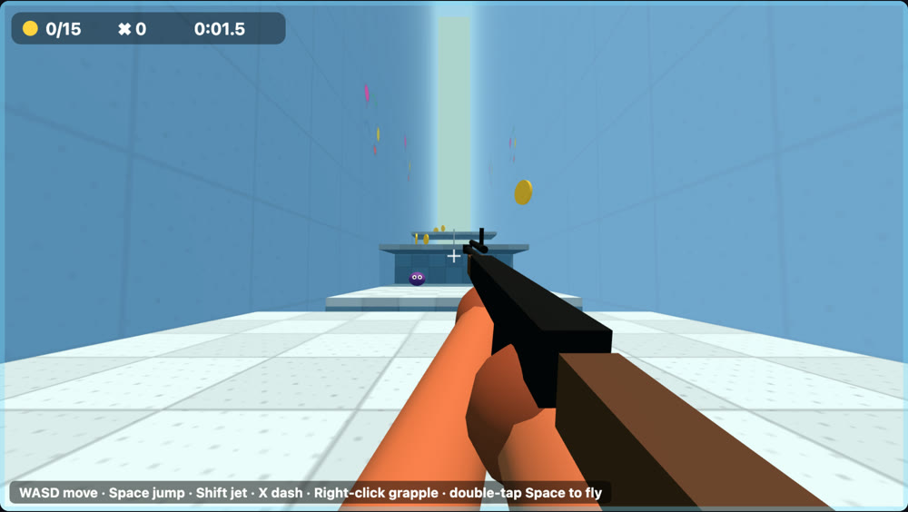
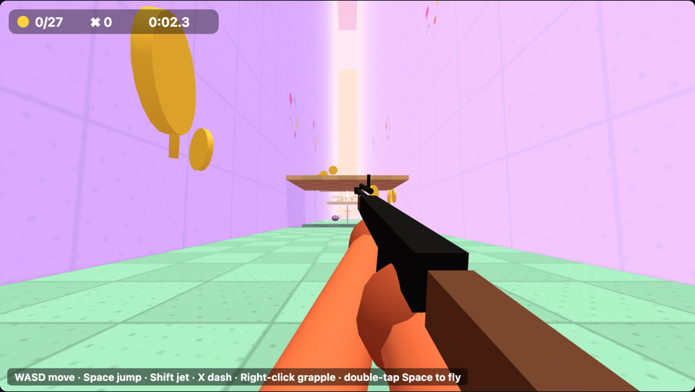
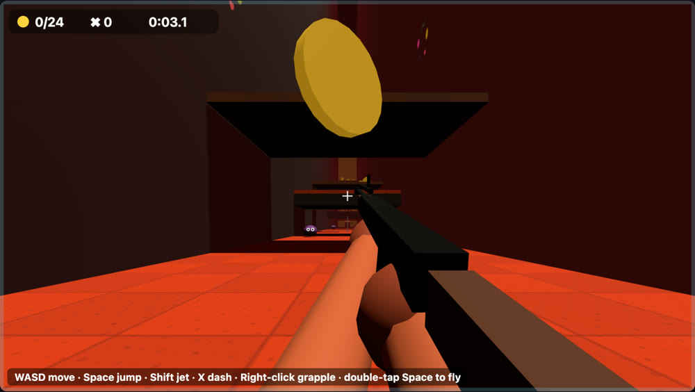
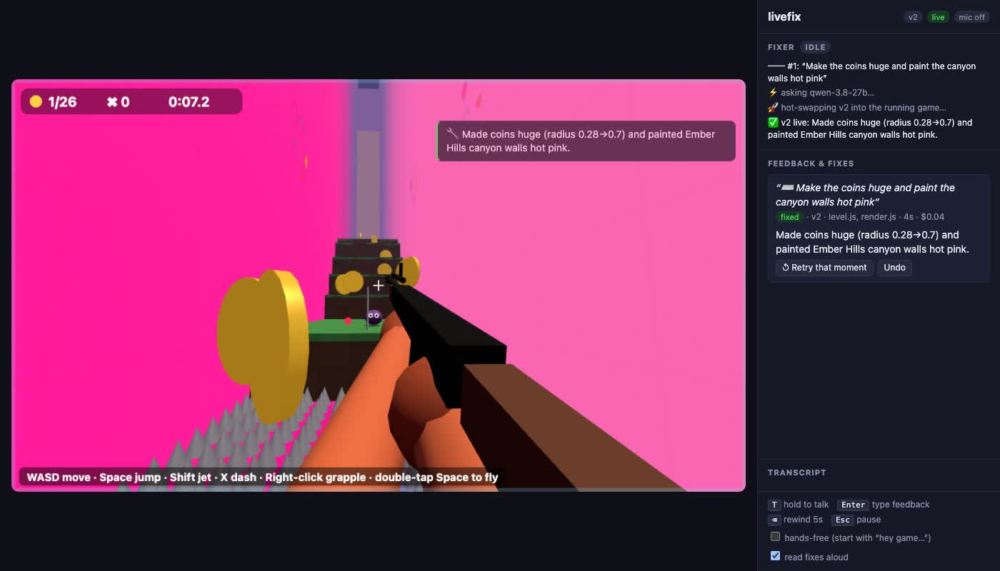

# livefix

**An experimental game-tweaking experience where you change the game in-game, live, without losing context.**

Say or type what you want while you play. An AI edits the game's code and hot-swaps it into the running game in seconds. You stay in the same spot, with the same coins and the same timer.



*A real fix, about 4 seconds from prompt to live. A scripted bot plays this clip, with the prompt typed and damage turned off so it survives the wait.*

This is an experiment, so expect rough edges. The included game, *Ember Run*, was built this way: it started as a small 2D platformer, and more than 100 requests made during play turned it into a first-person shooter with four themed levels, a boss, a jetpack and a grappling hook.

| | |
|---|---|
|  |  |
|  |  |

## How it feels

- **Everything is recorded on one clock.** That covers every input, game event, state sample, full-state snapshot, screenshot and your microphone.
- **Your words are lined up with the game.** When you hold <kbd>T</kbd> and say *"I fell right through that platform"*, the AI gets your words plus the 10 seconds of gameplay before them.
- **Changes happen while you play.** The AI reads that context and edits the game code. You can watch it work in the sidebar.
- **Nothing is lost.** The engine swaps the new code into the running game without touching the state.



## Quick start

Requirements:
- Node 20 or newer.
- Claude credentials: `ANTHROPIC_API_KEY`, or a machine where Claude Code is already signed in.
- Optional: `CEREBRAS_API_KEY`, for the fastest fixes. In testing, a typical fix took about 3 s with it and about 14 s with Claude alone.
- For voice: Chrome or Edge, or a transcription command in `LIVEFIX_TRANSCRIBE_CMD`. Typing works in any browser with WebGL.

```bash
npm install
```

```bash
npm start
```

Open http://localhost:5173, click **Play with mic**, then click the game to capture the mouse.

| key | what it does |
|---|---|
| Mouse | look around |
| W A S D / arrow keys | move |
| Q / E | turn without the mouse |
| Space | jump, press again in the air to double jump, double-tap to fly |
| Shift | jetpack |
| X | dash |
| Left click | shoot |
| Right click / H | grappling hook |
| F (hold) | charge and throw a bomb |
| **T (hold)** | talk: everything you say while holding it is a request |
| Enter | type a request instead (pauses the game while you type) |
| Backspace | rewind 5 seconds |
| Esc | release the mouse and pause |

Each request appears in the sidebar, with what the AI is reading and editing. Once the change is live, you'll see a toast and hear the summary read aloud. Every card has two buttons:
- **↺ Retry that moment** puts you back about 4 s before you spoke, running the new code.
- **Undo** reverts the most recent fix. Saying "undo that" does the same.

`npm run fresh` starts a new session. `npm start` picks up the last one where you left off, even after closing the tab or restarting the server.

## How it works

```
 browser                                             server (Node)
┌──────────────────────────────────────┐            ┌─────────────────────────────────────────────┐
│ engine/core.js   60 Hz fixed tick,   │ telemetry  │ session.js   writes sessions/<id>/…         │
│   owns the state, hot-swaps game/    │──────────▶ │                                             │
│ engine/recorder.js inputs · events · │  audio     │ context.js   builds feedback/NNN/ bundle:    │
│   10 Hz describe() · 1 Hz snapshots  │──────────▶ │   feedback.md (words ⟷ timeline), frames,   │
│   · 4 fps screenshots (in memory)    │ feedback   │   window.json (raw), voice clip             │
│ engine/voice.js  mic → continuous    │──────────▶ │                                             │
│   recording + speech-to-text + PTT   │            │ fixer.js     Claude Agent SDK, cwd = repo,  │
│                                      │  reload    │   may only edit game/, may only run          │
│ dry-run new code on a copy of state, │◀────────── │   tools/replay.mjs; then bump version        │
│ migrate(), swap; roll back if it     │  result    │   → browser dry-runs it → retry or restore   │
│ crashes within 15 s                  │──────────▶ │                                             │
└──────────────────────────────────────┘            └─────────────────────────────────────────────┘
```

**Why progress survives a reload.** The engine, not the game, owns two things: the clock and the state. `game/main.js` is a set of functions (`init`, `update`, `render`, `migrate`, `describe`) that run against that state. A reload imports the new module under a new URL (`/game@<version>/main.js`, so its relative imports are fresh too), calls `migrate(state)`, and swaps the function references. The state object never moves. The full contract is in [`game/GAME.md`](game/GAME.md).

**Safety net:**
- **Dry run first.** New code runs for 40 ticks, plus a fresh `init()` and a `render()`, on a copy of your live state before it touches the real thing. If it throws, it's rejected, the error goes back to Claude (up to two retries), and after that the previous code is restored.
- **Crash rollback.** If new code crashes within 15 s of going live, the engine puts the previous module back in memory and restores the last good tick. It then files the crash as feedback automatically.
- **Undo history.** Every fix snapshots `game/` first (`sessions/<id>/versions/`), which is what Undo uses.

**Deterministic replay.** `update()` uses `ctx.rng()` (its seed lives in the state) and a fixed timestep, and every input change is recorded per tick. So `node tools/replay.mjs sessions/<id>/feedback/NNN` can re-simulate the moment with the current code and print the original events next to the new ones. Claude uses it to check its fixes, and you can too.

**Manual edits hot-reload too.** Edit anything in `game/` in your own editor and it hot-swaps the same way.

## What gets recorded

```
sessions/<id>/
  telemetry.ndjson    inputs, events, describe() samples, engine marks, errors (epoch-ms `at` + tick `t`)
  snapshots.ndjson    full game state, once per second (and right after any reload/rewind)
  transcript.ndjson   every utterance with start/end time; push-to-talk ones flagged
  audio/              continuous mic recording; index.ndjson gives each segment's start time
  feedback/NNN/       feedback.md, window.json, frames/*.jpg, voice.webm, agent.ndjson (Claude's full run)
  versions/NNN-before/  copy of game/ before fix NNN
  fixes.ndjson, cards.json, meta.json, state.json
```

To find what you said at moment X, look up the audio segment whose `startAt` is just before X and seek to `X − startAt`.

## Configuration

| env var | default | |
|---|---|---|
| `PORT` | `5173` | |
| `LIVEFIX_MODEL` | `claude-sonnet-5-5` | model the fixer runs on |
| `LIVEFIX_EFFORT` | `low` | `medium` and `high` are slower and more careful |
| `LIVEFIX_TRANSCRIBE_CMD` | none | server-side speech-to-text for browsers that lack it: any command that prints the transcript of `{file}` (a WebM/Opus clip) to stdout, such as a small script running ffmpeg and whisper.cpp |
| `LIVEFIX_CLAUDE_PATH` | bundled | use a specific `claude` executable |
| `CEREBRAS_API_KEY` | none | try each fix on a very fast Cerebras model first, and use Claude if that fails or the model is unsure. This sends your feedback, recorded game data and code in `game/` to Cerebras |
| `LIVEFIX_FAST_MODEL` | `qwen-3.8-27b` | the Cerebras model to try first |
| `LIVEFIX_FAST_EFFORT` | `low` | `none` is about twice as fast, but its fixes are more often shallow |

These can also go in a `.env` file in the project root.

## Bring your own game

Replace the files in `game/` with your own. Keep the exports described in `game/GAME.md` and the engine handles the rest. The more meaningful `ctx.emit()` events and the more informative `describe()` your game provides, the better the fixer understands your feedback.

## Notes and limits

- **Speech-to-text.** It uses the browser's Web Speech API. In Chrome that sends your audio to Google's speech service. The raw recording itself stays on your machine. Firefox has no Web Speech API: use typing, or set `LIVEFIX_TRANSCRIBE_CMD`.
- **Experimental.** A change can load and still miss the point of your request. Nothing checks for that, so use Undo and ask again.
- **Cost and speed.** In testing, a typical fix cost about $0.02 and took about 3 s through Cerebras, or about $0.12 and 14 s through Claude. Each fix starts a new conversation with your request, the current code and the last five fixes, so "no, make it even higher" still works.
- **The Claude fixer is limited to `game/`.** A `PreToolUse` hook denies edits anywhere else and any shell command other than the replay tool. The Cerebras path can only write inside `game/`.
- **Your data.** `sessions/` holds your voice recordings and gameplay. It's gitignored, so keep it out of anything you publish. With a Cerebras key, your requests, recorded game data and code in `game/` go to Cerebras.
- **What happens to old state.** State created by older code only gets new fields through `migrate()`. If a fix changes how existing fields are used, Claude is told to handle that there.
